# Om Tyska — innehållet bestämmer sidans form

Designriktning och genomförande, 6 november 2026.

Utgångspunkten är användarens korrigering: varje referensbild ska förstås som en egen sidtyp eller presentationsprincip. Webbplatsen får flera tydliga rum inom samma verk. Pappret, de blå linjerna, bildtexterna och det återkommande namn- och nummersystemet skapar släktskapet. Läsningens uppgift avgör kompositionen.

Tio befintliga eller nytillkomna sidformer är genomförda i webbplatsen. Tre kulturella bildformat och ett litterärt läsformat finns som återanvändbara komponenter för senare innehåll. Kulturartiklar har inte skapats i denna etapp.

## Bild för bild

### 01. Det illustrerade lärouppslaget

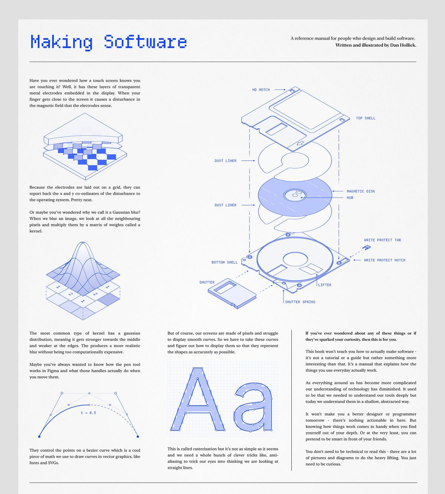

**Original:** `0dfdfd58c75680b07ae8f195246c7f26.jpg`

**Iakttagelse:** Making Software: en vit affisch med blå monospacerad huvudrubrik, seriftext, exploderade diagram, pilar och små tekniska bildtexter. Den stora figuren och de mindre marginalstudierna skapar flera läshastigheter.

**Översättning till Om Tyska:** Grammatikgenomgångar. Ett eget titelband, sammanfattning, lektionsdata och en separat läsyta med marginalinnehåll. På Y02 visas en kommenterad satsram med verbklammern ritad under orden. Figuren bygger på lektionsinnehållet.

**Status:** Genomfört. Sidväg: `/docs/syntax/satsram`.

Sidtypen kan granskas i leveransens bildgalleri (`04-larouppslag.jpg`).

### 02. Det delade resonemanget

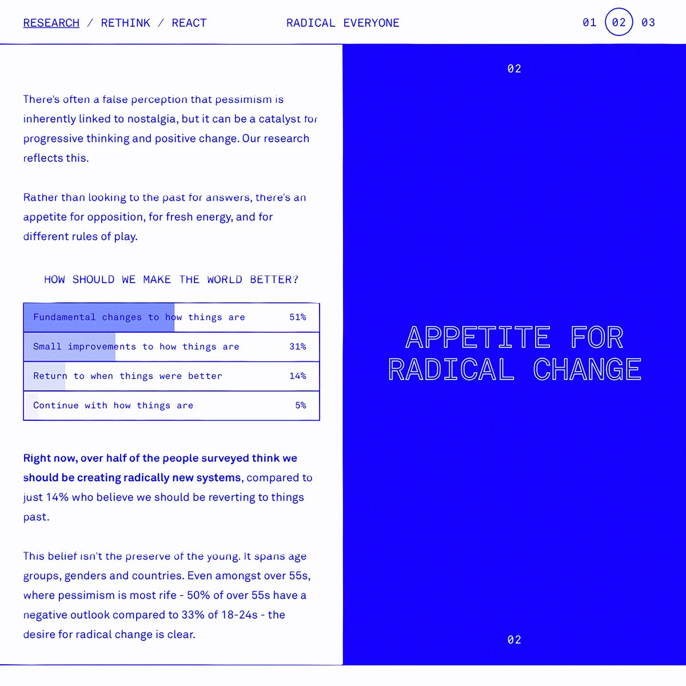

**Original:** `18b74452111a4d6c96966d2505a2dc6b.jpg`

**Iakttagelse:** Research / Rethink / React: en skarp, lika bred delning mellan vit analyssida och mättad blå yta. Små siduppgifter längs kanterna, sparsam typografi och ett stort budskap på det blå fältet.

**Översättning till Om Tyska:** Språkartiklar som reder ut en skillnad. Titel, ingress och läsingång till vänster; artikelns aktuella ordpar till höger. Den löpande texten fortsätter nedanför med en smal marginal för ämnen och avsnitt. Alla tio befintliga artiklar har ordpar anpassade till sitt ämne.

**Status:** Genomfört. Sidväg: `/blog/ich-habe-eller-ich-bin`.

Sidtypen kan granskas i leveransens bildgalleri (`07-jamforelseartikel.jpg`).

### 03. Den personliga studieboken

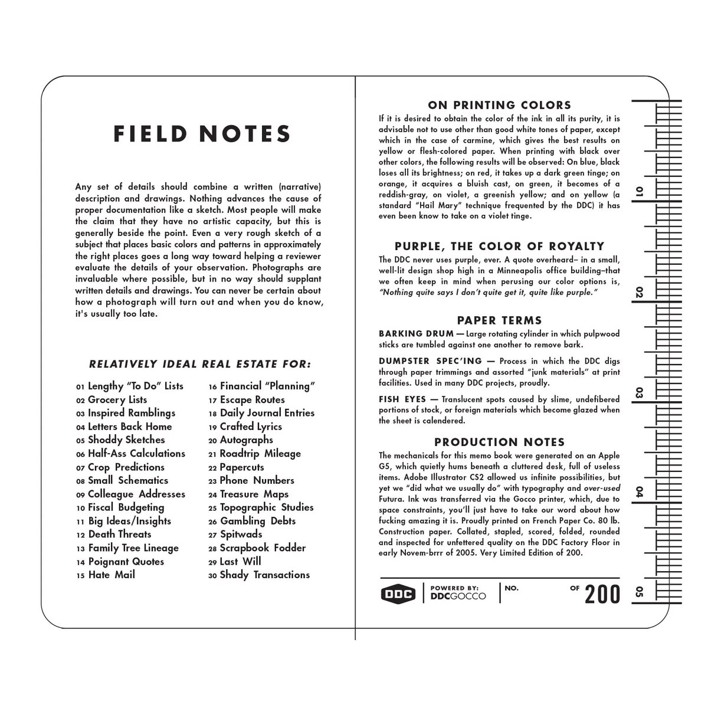

**Original:** `1a80e6a7d79f6351ff7077dc58b8a740.jpg`

**Iakttagelse:** Field Notes: ett inramat bokuppslag med mittfals, kraftig svart sansrubrik, täta numrerade register, små versala sektionsnamn och mätstreck längs ytterkanten.

**Översättning till Om Tyska:** Framstegssidan. Vänstersidan samlar läsning, övningsresultat och nästa steg. Högersidan blir en faktisk läsjournal med länkar till markerade genomgångar. Tomtillståndet är utformat som det första bladet. På mobil följer uppslagets två sidor efter varandra.

**Status:** Genomfört. Sidväg: `/framsteg`.

Sidtypen kan granskas i leveransens bildgalleri (`09-studiebok.jpg`).

### 04. Ämnesportalen

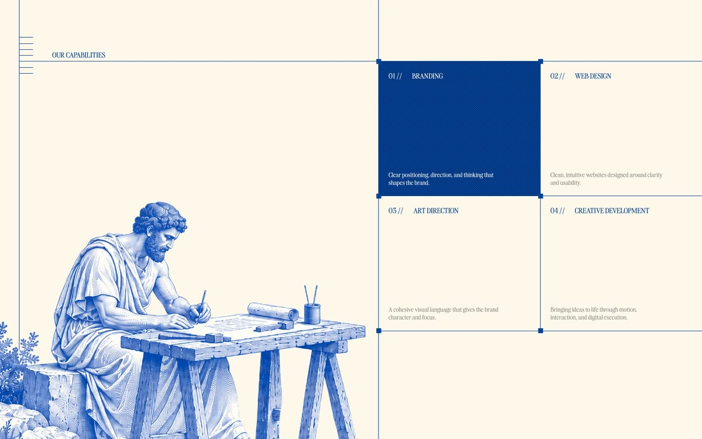

**Original:** `270c325835ec21c616c05988b2d4efc2.jpg`

**Iakttagelse:** Our Capabilities: varm pappersyta, stor fri bildyta till vänster, fyra lika tydliga destinationer till höger. Ett blått fält visar huvudvalet; tunna blå konstruktionslinjer och små hörnpunkter håller samman uppslaget.

**Översättning till Om Tyska:** Startsidan. Bild och introduktion ligger i vänsterfältet. Grammatikan, Lärstigen, Verkstaden och Anteckningar får var sitt hörn i portalen. Den befintliga gravyren visas i sin helhet. Under portalen följer ämnesregister och verktyg.

**Status:** Genomfört. Sidväg: `/`.

Sidtypen kan granskas i leveransens bildgalleri (`01-portal.jpg`).

### 05. Porträttbladet

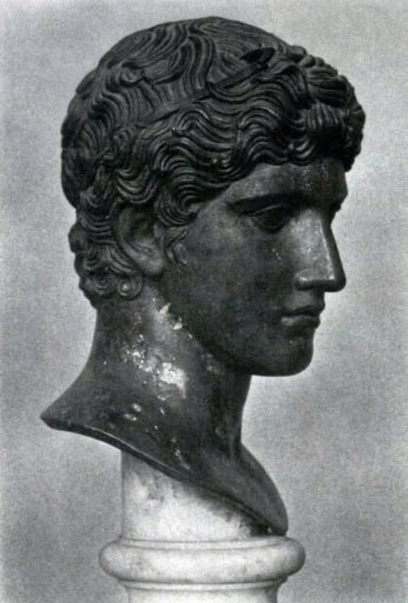

**Original:** `4fc93d0fca699df76b4e552656291fe1.jpg`

**Iakttagelse:** En tätt beskuren, mörkt patinerad huvudstudie mot ljus neutral bakgrund. Ljusets modellering, profilen och materialets yta bär uttrycket. Bilden ger en motiv- och presentationsprincip snarare än en färdig webbstruktur.

**Översättning till Om Tyska:** Framtida person- och författarporträtt: stor stående bild, separat identifiering, liten bildtext och en lugn intilliggande essäspalt. Komponenten PortraitSheet har bild, bildtext, rubrik och brödtext som uttryckliga innehållsfält.

**Status:** Förberedd komponent.

### 06. Den förgrenade studiekartan

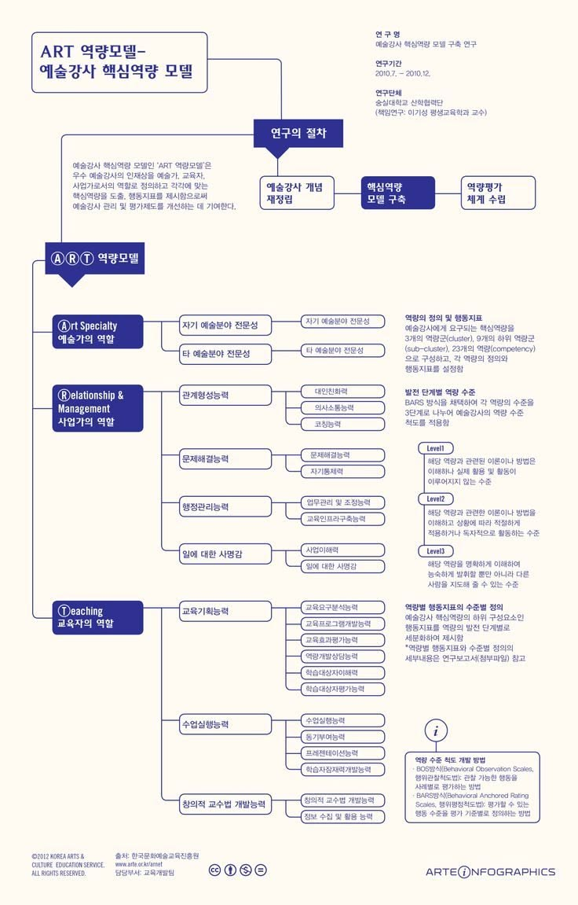

**Original:** `537e54450e1f38408ea5350f5be91398.jpg`

**Iakttagelse:** ART-diagrammet: blå kategorinoder med vit text, rundade konturlinjer, horisontella förbindelser till mindre ämnesnoder och en fristående förklaringsspalt. En tydlig rot och återkommande grenar ger överblick.

**Översättning till Om Tyska:** Lärstigen. Sju fyllda fasnoder följer en vertikal stam, och varje fas får förbundna lektionsnoder med stegnummer, nivå, tid och lässtatus. Legend och fashopp ligger vid sidan. Kartan visar studiefaser och nummerordning; den är inte en beräknad graf över alla förkunskapsrelationer.

**Status:** Genomfört. Sidväg: `/larstig`.

Sidtypen kan granskas i leveransens bildgalleri (`03-studiekarta.jpg`).

### 07. Referensdossiern

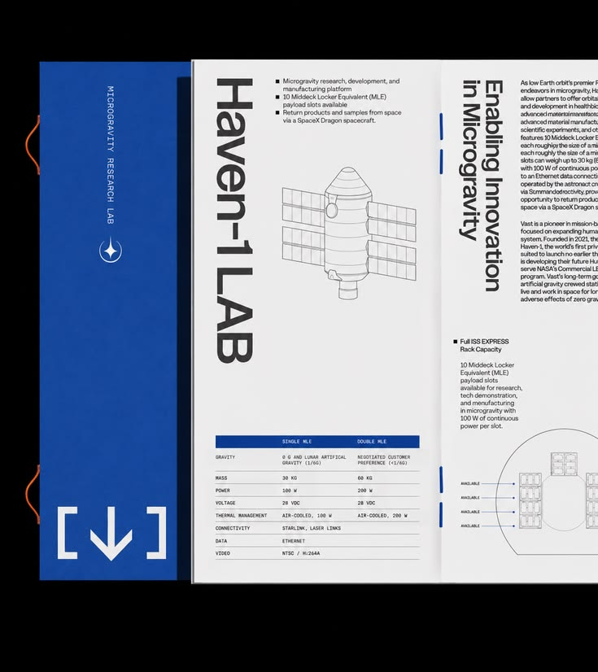

**Original:** `7aac591ac37b5cd93cc2eef383bea148.jpg`

**Iakttagelse:** Haven-1 LAB: blå vertikal rygg, stor svart sansrubrik, avgränsade faktauppgifter, tunna linjer och tekniska tabeller. Uppslaget känns som ett noggrant ordnat faktablad.

**Översättning till Om Tyska:** Avancerade grammatiktexter med X-id. Blå vertikal rygg, svart stor rubrik, lektionsdata och en avgränsad sammanfattning. Brödtexten behåller läsbar serif, medan avsnittsnamn och tabeller får ett mer tekniskt uttryck.

**Status:** Genomfört. Sidväg: `/docs/fordjupning/syntax/topologiska-falt-i-fullstandig-modell`.

Sidtypen kan granskas i leveransens bildgalleri (`05-fordjupning.jpg`).

### 08. Verket i sitt rum

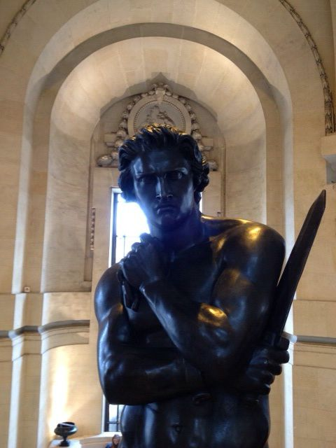

**Original:** `b8d5311f3252c8ed0d03f99302dbe01f.jpg`

**Iakttagelse:** Den mörka skulpturen i en ljus välvd nisch. Den stående kompositionen, stenarkitekturen och växlingen mellan kall metall och varmt rum ger en museal närvaro.

**Översättning till Om Tyska:** Framtida verkpresentationer. ObjectSheet låter en stor stående verksbild möta rubrik, verkdata och analys i en angränsande spalt. Hela bildrummet kan behållas; bilden behandlas som ett dokumenterat föremål med sammanhang.

**Status:** Förberedd komponent.

### 09. Verkstadsöversikten

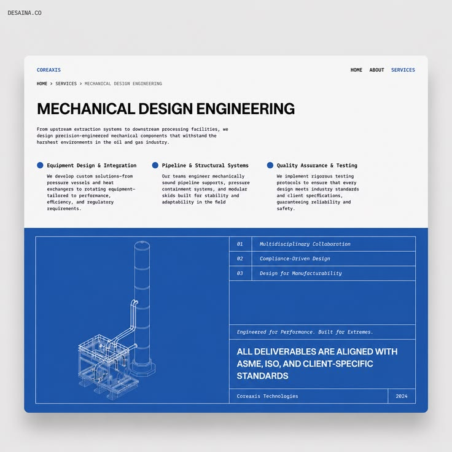

**Original:** `bd1f0db43cfffe12aef2c37198dcfe5c.jpg`

**Iakttagelse:** Mechanical Design Engineering: vit övre del med stor kraftig sansrubrik och tre numrerade förklaringsspalter. Den nedre delen är en blå teknisk panel med ritning till vänster och ett ordnat register till höger.

**Översättning till Om Tyska:** En ny övningsöversikt på /ovningar. Tre korta metodspalter leder till ett blått uppslag med en ritad tysk satsram och ett register över de fyra fungerande övningsverktygen samt repetitionen. Sidan är länkad från startsidan, Öva-menyn och sidfoten.

**Status:** Genomfört. Sidväg: `/ovningar`.

Sidtypen kan granskas i leveransens bildgalleri (`10-ovningsoversikt.jpg`).

### 10. Den mörka bildessän

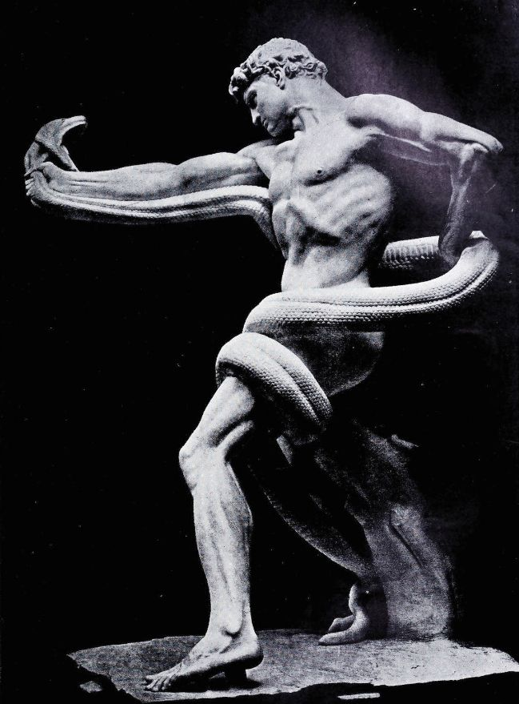

**Original:** `bd3cead165b8a9c7b145d433e9fbd4d8.jpg`

**Iakttagelse:** En starkt belyst skulpturkropp mot nästan svart bakgrund. Diagonalerna, de ljusa formerna och den stora kontrasten gör bilden monumental och dramatisk.

**Översättning till Om Tyska:** Framtida konst-, musik- och verkessäer där en bild kan bära inledningen. VisualEssay har en stor mörk bildplansch, separat bildtext och en efterföljande lässpalt. En artikel kan använda den när dess faktiska bildmaterial och ämne motiverar formatet.

**Status:** Förberedd komponent.

### 11. Innehållsregistret

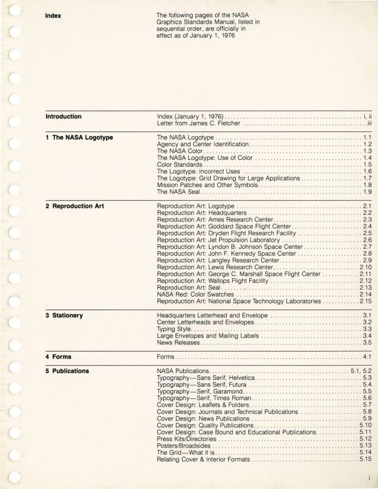

**Original:** `ea702a07c05ca20e5ae6ef1450719007.jpg`

**Iakttagelse:** NASA-indexet: hålad papperskant, svart text, rak kapitelhierarki, horisontella avdelare och punktlinjer mellan rubrik och sidkod. Kapitelrubrikerna bildar vänsterkolumn; innehållet står i en tät högerkolumn.

**Översättning till Om Tyska:** /grammatik. Grunddelen och den avancerade delen får egna volymband. Kapitelrubriker står till vänster, genomgångar med punktlinjer, nivå och stabilt id till höger. Avancerade avsnitt grupperas efter innehållets verkliga kategorier. Antal hämtas från tillgängliga innehållsfiler.

**Status:** Genomfört. Sidväg: `/grammatik`.

Sidtypen kan granskas i leveransens bildgalleri (`02-register.jpg`).

### 12. Den redaktionella tidskriften

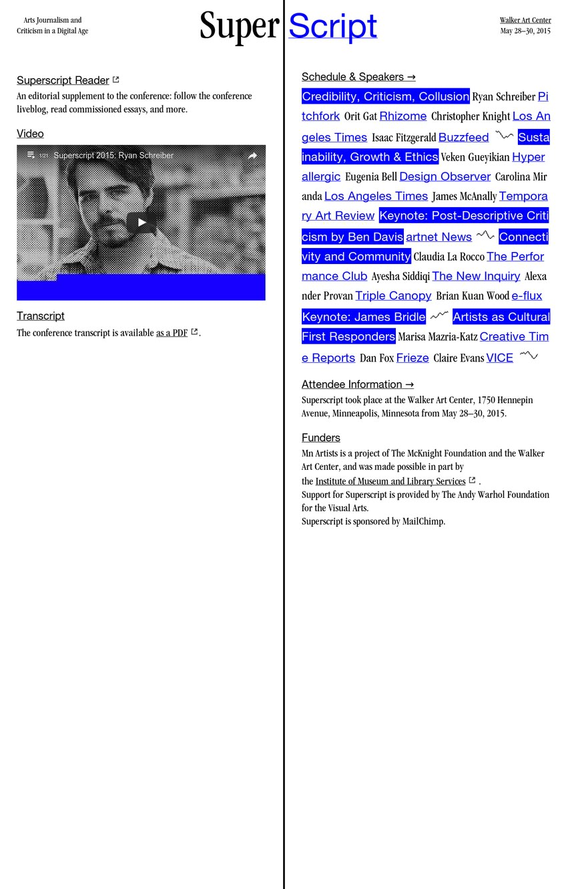

**Original:** `f1e28816f3525290c69d089cbe88e08c.jpg`

**Iakttagelse:** SuperScript: en stor delad seriflogotyp, en tydlig lodrät mittlinje, en redaktionell vänsterspalt och en tät högerspalt med blå understrukna och blåmarkerade titlar. Länkarna fungerar som själva typografiska formen.

**Översättning till Om Tyska:** Anteckningarnas ingång. Ett utvalt befintligt resonemang och en typografisk teckenstudie till vänster; ett artikelförtecknat, numrerat och blåmarkerat register till höger. Formatet kan senare bära recensioner och kulturtexter tillsammans med tydliga ämnes- och genreetiketter.

**Status:** Genomfört. Sidväg: `/blog`.

Sidtypen kan granskas i leveransens bildgalleri (`06-journal.jpg`).

### 13. Den blå arbetsytan

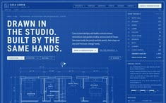

**Original:** `f458870db077ff5a97a069a67a3ca496.jpg`

**Iakttagelse:** Drawn in the studio: en genomgående blå ritningsmiljö med en stor flerradig versalrubrik, ljusa konstruktionslinjer, små tekniska uppgifter och en tät kontrollspalt. Referensfilen är mycket liten, så detaljer som inte går att läsa har inte tolkats som faktiska funktioner.

**Översättning till Om Tyska:** Meningsbygget. En helt blå, asymmetrisk introduktion följs av en rutad byggyta, numrerade flyttbara fraser, den aktuella meningen och en särskild återkopplingsspalt. Kontrollerna är riktiga HTML-knappar. Rätt och fel ordföljd ger fungerande återkoppling.

**Status:** Genomfört. Sidväg: `/meningsbygget`.

Sidtypen kan granskas i leveransens bildgalleri (`08-verkstad.jpg`).

## Gemensamma gestaltningsregler

- **Papper:** varm ljus yta i portalen, kartan och registret; vit yta i undervisning och journal; koboltblå yta i arbetsverktyget. De framtida bildessäerna får en mörk bakgrund.
- **Typografi:** serif bär resonemang, litterär läsning och porträtt. Sans ger tyngd åt register, kartor och dossiers. Monospacerad text används för figuruppgifter, identiteter och tekniska rubriker. Varje sidfamilj har egna proportioner.
- **Linjer:** en linje visar en innehållsrelation, en kolumn eller en avdelning. Studiekartans förbindelser hör till faserna. Satsramens linjer hör till en verklig grammatisk struktur.
- **Bildbehandling:** stora, avgränsade bildplancher och korta bildtexter. Byst, verkbild och arkitekturrum ges olika kompositioner. Bildmotiven ska väljas efter artikelns ämne.
- **Orientering:** ett gemensamt litet sidhuvud; sidans egna titlar, löpande metadata och folion får göra resten av arbetet. Öva-menyn har en ingång till hela verkstaden.
- **Mobil:** uppslagets sidor kommer i läsordning. Kapitelregister blir en kolumn; diagram byggs om till mindre grupper; verktygens kontroller och återkoppling följer varandra.
- **Pedagogik:** de befintliga betydelsebärande kasus- och satsdelsfärgerna behålls. Läst-status och godkända övningar är separata uppgifter även i studieboken.

## Komponenter för den kommande kulturdelen

`components/edition/CultureLayouts.tsx` exporterar fyra presentationskomponenter. De är förberedda och typkontrollerade; de har ännu inga publicerade kultursidor och har inte granskats med färdigt kulturinnehåll.

| Komponent | Lämpligt innehåll | Innehåll som tillförs vid publicering |
| --- | --- | --- |
| `PortraitSheet` | Författar-, tonsättar- eller tänkarporträtt | Namn, identifiering, stående bild, bildtext, essä |
| `ObjectSheet` | Presentation och analys av ett bestämt verk | Verkbild med sammanhang, verkdata, bildtext, analys |
| `VisualEssay` | Bildburen essä eller recension med starkt visuellt material | Stor bildplansch, bildtext, essärubrik och sammanhängande text |
| `LiterarySpread` | Utdrag ur exempelvis ett klassiskt litterärt verk | Verk och utgåva, författare, översättare/språk, utdrag, separata kommentarer |

Det litterära formatet har en bred serifspalt för originaltext eller översättning och en smalare kommentarspalt. Källuppgifter ligger i ett eget band. På mobil följer kommentarerna efter texten. När kulturinnehållet tillkommer väljs format uttryckligen för varje artikel; någon automatisk genreklassificering finns inte i denna etapp.

## Teknisk överlämning

- `app/page.*`: den fyrdelade ämnesportalen.
- `app/grammatik/page.*`: innehållsregistret, inklusive faktiskt tillgängliga fördjupningar.
- `app/larstig/page.*`: studiekarta med lässtatus och fasnavigation.
- `components/edition/LessonHeader.*` och `SentencePlate.*`: genomgångens titeluppslag och satsramens figur.
- `app/docs/[...slug]/doc.module.css`: undervisningens vita läsyta och dossierns typografi.
- `app/blog/page.*` och `app/blog/[slug]/page.*`: journalregister och delat artikeluppslag.
- `app/ovningar/page.*`: ny övningsöversikt.
- `app/meningsbygget/page.*`: blå arbetsyta med befintliga övningsdata och svarskontroll.
- `app/framsteg/page.*`: studiebok och läsjournal.
- `components/edition/CultureLayouts.*`: framtida kulturella sidformer.

MDX-innehållet, lektions-id:n och lagringsnycklarna behålls. Innehållsmodellen används för titel, ingress, kategorisering och nivåuppgifter. Den kommenterade satsramen visas på den lektion där den hör hemma. Övriga genomgångar får det gemensamma lärouppslaget; framtida ämnesfigurer kan läggas till med samma figurkontrakt.

Tre funktionella korrigeringar gjordes i samband med genomförandet: introduktionskomponenten förstår både `goals` och `objectives` samt registerreferenser; lärstigen tar bara med steg som tillhör dess sju definierade grundfaser, så att avancerade steg 101+ inte felaktigt hamnar i fas 1; upprepad kontroll av samma rätta mening ger en enda genomförd mening i verktyget. En negativ mobilmarginal i snabbquizet rättades efter visuell kontroll.

## Nästa innehållsetapp

1. Välj en verklig kulturartikel och en litterär text som pilot.
2. Fyll respektive presentationskomponent med komplett material och källuppgifter.
3. Granska radlängd, bildbeskärning och kommentarernas placering med just det materialet på stor och liten skärm.
4. Lägg till kulturens navigation och register när det finns innehåll att navigera till.

## Verifiering av genomförandet

- Produktionsbygge med Next.js 15.5.24: godkänt; 223 genererade sidor i den kontrollerade innehållsversionen.
- TypeScript-kontroll: godkänd.
- Projektets åtta befintliga tester för svarskontroll: godkända.
- Tio representativa sidformer granskade i webbläsare vid 1440 × 1000 och 390 × 844. En synlig huvudrubrik per sida; ingen horisontell sidöverströmning i dessa vyer. Mätresultaten finns i `webblasarkontroll.json`.
- Flytt av meningsdelar, felaktigt och korrekt svar samt skydd mot dubbel poängräkning provade i Meningsbygget.
- Markering som läst kontrollerad mot den efterföljande läsjournalen. Mobilmeny, sökresultat och läslägesväxling provade.
- Inga konsolfel registrerade under webbläsarkontrollen av produktionsbygget.
- Förberedda kulturkomponenter har typkontrollerats. Deras slutliga läsrytm och bildbeskärning granskas när verkligt kulturinnehåll finns.

Kontrollen är en representativ design- och funktionskontroll. Den är inte en språkvetenskaplig faktagranskning av de 195 genomgångarna.
